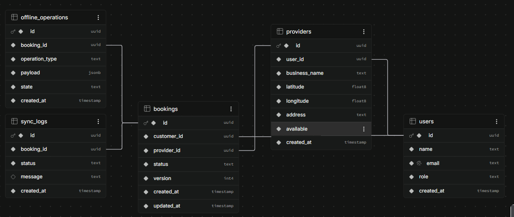

# Database Schema

The application uses **Supabase (PostgreSQL)** as its backend database. The database schema is designed to support user management, provider management, booking operations, offline synchronization, and optimistic conflict resolution. The schema follows a normalized relational design to minimize data redundancy while maintaining referential integrity through foreign key constraints.

---

## Entity Relationship Diagram

  

The database consists of five primary tables, each responsible for a specific aspect of the application's functionality.

---

# Users Table

The **Users** table serves as the central identity table for the application. Every authenticated user is stored here and assigned a role that determines the features accessible within the system.

<table>
  <thead>
    <tr>
      <th align="left">Column</th>
      <th align="left">Type</th>
      <th align="left">Description</th>
    </tr>
  </thead>
  <tbody>
    <tr>
      <td><code>id</code></td>
      <td>UUID</td>
      <td>Unique identifier generated automatically for every user.</td>
    </tr>
    <tr>
      <td><code>name</code></td>
      <td>TEXT</td>
      <td>Full name of the user.</td>
    </tr>
    <tr>
      <td><code>email</code></td>
      <td>TEXT</td>
      <td>Unique email address used for authentication.</td>
    </tr>
    <tr>
      <td><code>role</code></td>
      <td>TEXT</td>
      <td>Defines whether the user is a <code>customer</code> or a <code>provider</code>.</td>
    </tr>
    <tr>
      <td><code>created_at</code></td>
      <td>TIMESTAMP</td>
      <td>Stores the account creation timestamp.</td>
    </tr>
  </tbody>
</table>

### Purpose

The Users table forms the foundation of the Role-Based Access Control (RBAC) system. Every authenticated user is assigned either a **Customer** or **Provider** role, allowing the application to present different dashboards and restrict access to provider-specific functionality.

---

# Providers Table

The **Providers** table stores business information associated with provider accounts.

<table>
  <thead>
    <tr>
      <th align="left">Column</th>
      <th align="left">Type</th>
      <th align="left">Description</th>
    </tr>
  </thead>
  <tbody>
    <tr>
      <td><code>id</code></td>
      <td>UUID</td>
      <td>Unique provider identifier.</td>
    </tr>
    <tr>
      <td><code>user_id</code></td>
      <td>UUID</td>
      <td>References the corresponding user account.</td>
    </tr>
    <tr>
      <td><code>business_name</code></td>
      <td>TEXT</td>
      <td>Name of the provider's business.</td>
    </tr>
    <tr>
      <td><code>latitude</code></td>
      <td>DOUBLE PRECISION</td>
      <td>Actual latitude of the provider.</td>
    </tr>
    <tr>
      <td><code>longitude</code></td>
      <td>DOUBLE PRECISION</td>
      <td>Actual longitude of the provider.</td>
    </tr>
    <tr>
      <td><code>address</code></td>
      <td>TEXT</td>
      <td>Physical business address.</td>
    </tr>
    <tr>
      <td><code>available</code></td>
      <td>BOOLEAN</td>
      <td>Indicates whether the provider is currently accepting bookings.</td>
    </tr>
    <tr>
      <td><code>created_at</code></td>
      <td>TIMESTAMP</td>
      <td>Provider creation timestamp.</td>
    </tr>
  </tbody>
</table>

### Purpose

The Providers table extends the basic user profile with provider-specific information. Exact geographic coordinates are securely stored in the database but are never exposed directly to customers. Instead, the application applies the deterministic geo-obfuscation algorithm before displaying provider locations on the map.

The **available** field was also designed to support the planned conflict resolution workflow by determining whether a provider can accept new bookings during synchronization.

---

# Bookings Table

The **Bookings** table stores all booking requests created by customers.

<table>
  <thead>
    <tr>
      <th align="left">Column</th>
      <th align="left">Type</th>
      <th align="left">Description</th>
    </tr>
  </thead>
  <tbody>
    <tr>
      <td><code>id</code></td>
      <td>UUID</td>
      <td>Unique booking identifier.</td>
    </tr>
    <tr>
      <td><code>customer_id</code></td>
      <td>UUID</td>
      <td>References the customer who created the booking.</td>
    </tr>
    <tr>
      <td><code>provider_id</code></td>
      <td>UUID</td>
      <td>References the selected provider.</td>
    </tr>
    <tr>
      <td><code>status</code></td>
      <td>TEXT</td>
      <td>Current booking status (PENDING, CONFIRMED or CANCELLED).</td>
    </tr>
    <tr>
      <td><code>version</code></td>
      <td>INTEGER</td>
      <td>Version number used for optimistic concurrency control.</td>
    </tr>
    <tr>
      <td><code>created_at</code></td>
      <td>TIMESTAMP</td>
      <td>Booking creation timestamp.</td>
    </tr>
    <tr>
      <td><code>updated_at</code></td>
      <td>TIMESTAMP</td>
      <td>Last modification timestamp.</td>
    </tr>
  </tbody>
</table>

### Purpose

The Bookings table records all customer booking requests and associates them with a provider. The booking status tracks the lifecycle of each request.

The **version** column was introduced to support **optimistic concurrency control**. During synchronization, the application was intended to compare the local booking version with the server version to detect stale updates before committing changes.

---

# Offline Operations Table

The **Offline Operations** table was designed to support the application's offline-first architecture.

<table>
  <thead>
    <tr>
      <th align="left">Column</th>
      <th align="left">Type</th>
      <th align="left">Description</th>
    </tr>
  </thead>
  <tbody>
    <tr>
      <td><code>id</code></td>
      <td>UUID</td>
      <td>Unique operation identifier.</td>
    </tr>
    <tr>
      <td><code>booking_id</code></td>
      <td>UUID</td>
      <td>Associated booking.</td>
    </tr>
    <tr>
      <td><code>operation_type</code></td>
      <td>TEXT</td>
      <td>CREATE, UPDATE or DELETE operation.</td>
    </tr>
    <tr>
      <td><code>payload</code></td>
      <td>JSONB</td>
      <td>Serialized booking information required for synchronization.</td>
    </tr>
    <tr>
      <td><code>state</code></td>
      <td>TEXT</td>
      <td>Current synchronization state.</td>
    </tr>
    <tr>
      <td><code>created_at</code></td>
      <td>TIMESTAMP</td>
      <td>Operation creation timestamp.</td>
    </tr>
  </tbody>
</table>

### Purpose

This table acts as the persistence layer for queued operations created while the device is offline.

Each operation stores:

- The affected booking
- The type of operation
- Serialized booking data
- Current synchronization status

Supported synchronization states include:

- QUEUED
- SYNCING
- SUCCESS
- FAILED
- CONFLICT

Although the synchronization workflow was not fully completed within the assessment timeframe, the database schema was designed to accommodate the intended offline synchronization process.

---

# Sync Logs Table

The **Sync Logs** table records the outcome of synchronization attempts.

<table>
  <thead>
    <tr>
      <th align="left">Column</th>
      <th align="left">Type</th>
      <th align="left">Description</th>
    </tr>
  </thead>
  <tbody>
    <tr>
      <td><code>id</code></td>
      <td>UUID</td>
      <td>Unique log identifier.</td>
    </tr>
    <tr>
      <td><code>booking_id</code></td>
      <td>UUID</td>
      <td>Associated booking.</td>
    </tr>
    <tr>
      <td><code>status</code></td>
      <td>TEXT</td>
      <td>Synchronization result (SUCCESS, FAILED or CONFLICT).</td>
    </tr>
    <tr>
      <td><code>message</code></td>
      <td>TEXT</td>
      <td>Additional details describing the synchronization outcome.</td>
    </tr>
    <tr>
      <td><code>created_at</code></td>
      <td>TIMESTAMP</td>
      <td>Time the log entry was created.</td>
    </tr>
  </tbody>
</table>

### Purpose

The Sync Logs table provides an audit trail for synchronization attempts. Recording synchronization outcomes simplifies debugging and helps monitor the behavior of the offline synchronization system.

---

# Database Relationships

<table>
  <thead>
    <tr>
      <th align="left">Parent Table</th>
      <th align="left">Child Table</th>
      <th align="left">Relationship</th>
    </tr>
  </thead>
  <tbody>
    <tr>
      <td>Users</td>
      <td>Providers</td>
      <td>One-to-One</td>
    </tr>
    <tr>
      <td>Users</td>
      <td>Bookings</td>
      <td>One-to-Many (Customer)</td>
    </tr>
    <tr>
      <td>Providers</td>
      <td>Bookings</td>
      <td>One-to-Many</td>
    </tr>
    <tr>
      <td>Bookings</td>
      <td>Offline Operations</td>
      <td>One-to-Many</td>
    </tr>
    <tr>
      <td>Bookings</td>
      <td>Sync Logs</td>
      <td>One-to-Many</td>
    </tr>
  </tbody>
</table>

All relationships are enforced using **foreign key constraints** with **ON DELETE CASCADE**, ensuring referential integrity throughout the database.

---

# Performance Optimizations

To improve database performance, indexes have been created on frequently queried columns, including:

- Provider lookup by user
- Customer booking lookup
- Provider booking lookup
- Booking version lookup
- Offline operation lookup
- Synchronization log lookup

These indexes improve query performance during booking retrieval, synchronization, and future conflict detection.
