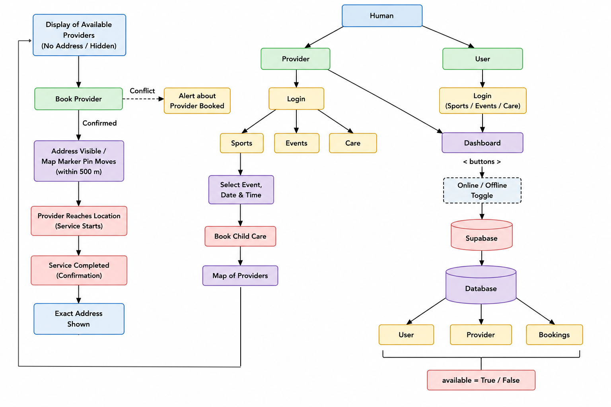

# System Architecture

The application follows a feature-based modular architecture combined with a shared infrastructure layer. This approach isolates business logic by domain while allowing common functionality to be reused across the application.

The overall architecture is designed around four primary layers:

<p align="center">
  
</p>

Each layer has a clearly defined responsibility, reducing coupling between features and making the application easier to extend and maintain.

---

## Feature-Based Module Isolation

Instead of organizing the project by file type (components, pages, hooks, etc.), the application is organized by business domain.

Current feature modules include:

```
src/
│
├── modules/
│   ├── sports/
│   ├── events/
│   └── care/
│
└── shared/
```

Each module owns its own:

- UI components
- Pages
- Business logic
- Data handling
- Feature-specific utilities

This means changes to one module have minimal impact on the others.

### Benefits

- Better scalability
- Easier maintenance
- Independent feature development
- Reduced code coupling
- Improved code readability

---

## Shared Layer

Functionality used across multiple modules is placed inside the `shared` directory.

Examples include:

- Authentication
- Repository classes
- Shared UI components
- Common TypeScript types
- Utility functions

This prevents code duplication while keeping feature modules focused on their own responsibilities.

---

## State Management

The application uses React Context together with React Hooks for state management.

### Authentication State

Authentication is managed globally using an `AuthContext`.

The context stores information such as:

- Current user
- User role
- Login status

This allows all feature modules to access authentication data without passing props through multiple components.

---

### Local Feature State

Each feature module manages its own local state using React Hooks.

Examples include:

- Provider list
- Booking form data
- Loading indicators
- Error messages
- Search filters

Keeping state close to where it is used improves readability and reduces unnecessary re-renders.

---

### Data Access Layer

The application separates business logic from database operations using the Repository Pattern.

Instead of calling Supabase directly from UI components, all database interactions pass through repository classes.

Example responsibilities include:

- Retrieving providers
- Creating bookings
- Updating provider availability
- Synchronizing offline bookings

This abstraction makes the application easier to maintain and simplifies future backend changes.

---

## Authentication Flow

The authentication flow follows a simple layered approach.

```
User
   │
   ▼
Login Screen
   │
   ▼
AuthService
   │
   ▼
mockUser
   │
   ▼
AuthContext
   │
   ▼
Role-Based Access Control
```

After successful authentication, the user's role determines which parts of the application can be accessed.

---

## Data Flow

The application follows a unidirectional data flow.

```
User Action
      │
      ▼
React Component
      │
      ▼
Repository
      │
      ▼
Supabase
      │
      ▼
Repository
      │
      ▼
React Component
      │
      ▼
Updated UI
```

This predictable flow makes debugging easier and ensures UI components remain independent of the underlying database implementation.

---

## Architectural Benefits

The chosen architecture provides several advantages:

- Clear separation of concerns
- Modular feature development
- Reusable shared services
- Centralized authentication
- Improved maintainability
- Easier testing
- Scalable codebase suitable for future feature expansion